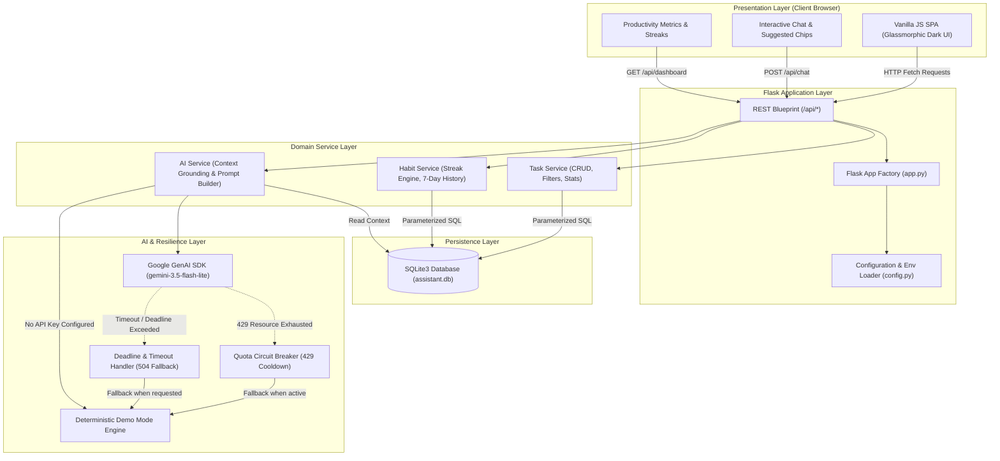

# AI Life Assistant

An intelligent, full-stack personal productivity dashboard and context-aware conversational assistant built with Python, Flask, SQLite, and Google Gemini.

[](https://ai-life-assistant-cljt.onrender.com/)
[](https://github.com/Kanishka-T-S/ai-life-assistant)
[](https://www.python.org/)
[](https://flask.palletsprojects.com/)
[](https://www.sqlite.org/)
[](https://ai.google.dev/)
[](https://pytest.org/)
[](https://github.com/Kanishka-T-S/ai-life-assistant/actions)

---

## 📌 Overview & Problem Statement

### The Problem
Traditional to-do applications are passive checklists that easily accumulate into daunting backlogs. They lack situational awareness, fail to account for realistic focus windows, and provide no contextual guidance on how to sequence competing priorities when schedules shift.

### The Solution
**AI Life Assistant** bridges structured task management with a context-grounded Generative AI companion. Rather than operating as an isolated chatbot, the assistant dynamically grounds its recommendations in the user's real SQLite database records—including overdue deadlines, priority distributions, and active habit streaks.

The system features robust resilience engineering, including circuit-breaker quota protection, timeout failover, request latency logging, and a deterministic offline Demo Mode fallback.

- 🌐 **Live Application**: [https://ai-life-assistant-cljt.onrender.com/](https://ai-life-assistant-cljt.onrender.com/)
- 💻 **Source Code**: [https://github.com/Kanishka-T-S/ai-life-assistant](https://github.com/Kanishka-T-S/ai-life-assistant)

---

## 🏗️ Architecture & System Design

The application follows a modular tiered architecture separating the client-side single-page presentation layer from the REST API routes, core domain services, data persistence, and external LLM services.



---

## 🌟 Key Features

### 1. 📊 Interactive Productivity Dashboard
- **Live Aggregated Metrics**: Tracks pending tasks, completed tasks, active habits, and today's completed habit count directly from SQLite.
- **Productivity Progress Meter**: Computes a dynamic composite score based on task execution rates and habit consistency.
- **Daily Motivational Wisdom**: Curated, rotating quotes to encourage daily focus.
- **Upcoming Tasks Feed**: Highlights impending deadlines with inline completion checkboxes.

### 2. 🤖 Context-Aware AI Assistant & Resilience Engineering
- **Live Gemini Integration**: Powered by the official Google GenAI SDK (`google-genai`) using the stable, high-throughput `gemini-3.5-flash-lite` model.
- **Context Grounding**: System instructions dynamically inject the user's overdue tasks, today's schedule, high-priority items, and habit streak counts into prompt context.
- **429 Quota Circuit Breaker**: Detects `RESOURCE_EXHAUSTED` errors and enters an active cooldown window to avoid spamming the upstream API.
- **Timeout & Deadline Handling (HTTP 504)**: Enforces an explicit 15-second request deadline. When timeouts occur, users receive an immediate option to retry or generate a simulated response.
- **Deterministic Demo Mode Fallback**: Provides simulated, structured responses when no API key is provided or when fallback is explicitly requested.
- **Safe Response Extraction**: Parses candidate parts safely to protect against token cutoffs.
- **Zero API Key Leakage**: All error logs and client responses pass through an error sanitization pipeline to prevent credential exposure.
- **Conversational Memory**: Maintains multi-turn context across chat exchanges.

### 3. 📋 Complete Task Management (CRUD)
- **Full Lifecycle**: Create, read, update, and delete tasks with title, description, due date, priority (`High`, `Medium`, `Low`), and category (`Work`, `Personal`, `Study`, `Health`, etc.).
- **Client-Side Filtering**: Instant view switching across `All`, `Due Today`, `Pending`, `Completed`, and `Overdue`.
- **Search & Multi-Sort**: Debounced search across titles, descriptions, and categories; sortable by due date, priority, or creation date.
- **Inline Toggling**: Immediate status toggling backed by database transactions.

### 4. 🔥 Habit Tracker & Calendar Streak Engine
- **Accurate Continuous Streaks**: Computes continuous calendar day streaks from SQLite completion logs without false breaks.
- **Duplicate Prevention**: Enforced at the schema level via `UNIQUE(habit_id, date)` constraints.
- **7-Day Visual History**: Micro indicator pills showing rolling completion history across the past week.

### 5. 📅 Structured Daily Planner
- **Focus Time Blocks**: Organizes activities into Morning Focus, Afternoon Execution, and Evening Wrap-up blocks.
- **Overdue Attention Alerts**: Flags overdue commitments requiring immediate action.
- **Ethical Recommendation Model**: Clearly demarcates AI suggestions as non-destructive guidelines that never modify task records without user confirmation.

---

## 🛠️ Technology Stack

| Layer | Component | Description |
|---|---|---|
| **Backend** | Python 3.12, Flask 3.1 | Application factory pattern, RESTful blueprint routing |
| **WSGI Server** | Gunicorn 23.0+ | Production WSGI HTTP server for cloud deployments |
| **Database** | SQLite3 | Local relational storage with foreign keys and parameterized SQL |
| **AI Integration** | Google GenAI SDK (`google-genai` v2.0+) | Official SDK utilizing model `gemini-3.5-flash-lite` |
| **Frontend** | HTML5, Vanilla CSS3, Vanilla JavaScript | Responsive glassmorphism interface, dark mode, zero frontend frameworks |
| **Testing** | Pytest 8.0+ | Automated test suite with isolated in-memory/temp database fixtures |
| **CI / CD** | GitHub Actions | Automated linting and test execution on push and pull requests |
| **Deployment** | Render | Fully managed cloud web service hosting |

---

## 📁 Repository Structure

```
ai-life-assistant/
├── .github/
│   └── workflows/
│       └── tests.yml          # GitHub Actions CI workflow (Python 3.12 + Pytest)
├── routes/
│   ├── __init__.py
│   └── api.py                 # REST API endpoints (/api/tasks, /api/habits, /api/chat, etc.)
├── services/
│   ├── __init__.py
│   ├── ai_service.py          # Gemini API client, circuit breaker, timeout handling & demo mode
│   ├── habit_service.py       # Habit tracking, streak engine, and 7-day completion history
│   └── task_service.py        # Task CRUD operations, filtering, sorting, and aggregate stats
├── static/
│   ├── css/
│   │   └── style.css          # Glassmorphic dark-mode CSS design system
│   └── js/
│       └── app.js             # SPA state management, asynchronous API requests, and chat UI
├── templates/
│   ├── index.html             # Single-page application shell
│   ├── 404.html               # Custom 404 Not Found error page
│   └── 500.html               # Custom 500 Internal Server Error page
├── tests/
│   ├── __init__.py
│   ├── conftest.py            # Pytest fixtures and temporary SQLite database factory
│   ├── test_ai.py             # Chat validation, demo fallback, timeout, and quota error tests
│   ├── test_dashboard.py      # Aggregated metrics and calculation tests
│   ├── test_habits.py         # Streak algorithm, duplicate prevention, and history tests
│   └── test_tasks.py          # Task CRUD, filtering, validation, and route error tests
├── .env.example               # Environment variables template
├── .gitignore                 # Excludes .env, virtual environments, *.db, and caches
├── app.py                     # Flask application factory, entry point, and web route handlers
├── config.py                  # Centralized configuration class and environment variable loader
├── database.py                # Database connection lifecycle, schema initialization, and migrations
├── requirements.txt           # Production and test Python dependencies
└── README.md                  # Technical documentation and project overview
```

---

## 🚀 Local Installation & Setup

Follow these instructions in **Windows PowerShell** to run the project locally:

### 1. Clone the Repository
```powershell
git clone https://github.com/Kanishka-T-S/ai-life-assistant.git
cd ai-life-assistant
```

### 2. Create and Activate a Virtual Environment
```powershell
python -m venv .venv
.venv\Scripts\Activate.ps1
```

### 3. Install Dependencies
```powershell
pip install -r requirements.txt
```

### 4. Configure Environment Variables
Copy the template configuration file:
```powershell
copy .env.example .env
```

Review the configurable environment variables in `.env`:
| Variable | Default Value | Description |
|---|---|---|
| `DATABASE_PATH` | `assistant.db` | Path to the local SQLite database file |
| `GEMINI_API_KEY` | *(empty)* | Google AI Studio Gemini API key. If omitted, operates in Demo Mode |
| `GEMINI_MODEL` | `gemini-3.5-flash-lite` | Supported Google Gemini model code |
| `GEMINI_TIMEOUT_SECONDS` | `15` | Request timeout limit in seconds |
| `FLASK_ENV` | `development` | Flask runtime environment (`development` / `production`) |
| `SECRET_KEY` | *(dev key)* | Flask session signing key |
| `PORT` | `5000` | Port for local web server |

> **Note on AI Keys:** If `GEMINI_API_KEY` is left blank, the application automatically runs in **Demo Mode**, returning intelligent deterministic responses. To enable live Gemini AI, generate a free API key from [Google AI Studio](https://aistudio.google.com/) and assign it to `GEMINI_API_KEY` in `.env`.

### 5. Launch the Application
```powershell
python app.py
```
Open your browser and navigate to:
👉 **`http://127.0.0.1:5000`**

For production-style local execution using Gunicorn:
```powershell
gunicorn --bind 127.0.0.1:5000 app:app
```

---

## 🧪 Automated Testing

The project includes an end-to-end automated test suite covering API validation, task and habit operations, streak calculations, latency measurements, timeout simulation, and 429 quota circuit breaking. All tests execute against an isolated temporary SQLite database fixture.

Run tests using Pytest:
```powershell
python -m pytest -v
```

### Verified Test Results (29 Passing Tests):
```
tests/test_ai.py::test_ai_chat_validation PASSED                         [  3%]
tests/test_ai.py::test_ai_chat_demo_mode_fallback PASSED                 [  6%]
tests/test_ai.py::test_ai_chat_suggested_prompts PASSED                  [ 10%]
tests/test_daily_planner_summary_endpoint PASSED                         [ 13%]
tests/test_ai.py::test_ai_chat_timing_included PASSED                    [ 17%]
tests/test_ai.py::test_ai_chat_timeout_handling PASSED                   [ 20%]
tests/test_ai.py::test_ai_chat_upstream_error_handling PASSED            [ 24%]
tests/test_ai.py::test_is_quota_or_rate_limit_error_detection PASSED     [ 27%]
tests/test_ai.py::test_ai_chat_quota_exhausted_friendly_message PASSED   [ 31%]
tests/test_ai.py::test_ai_chat_avoids_repeated_retries_during_quota_cooldown PASSED [ 34%]
tests/test_ai.py::test_ai_chat_explicit_demo_fallback_when_quota_exhausted PASSED [ 37%]
tests/test_api_key_never_exposed_in_quota_or_generic_errors PASSED       [ 41%]
tests/test_tasks_and_habits_remain_fully_functional_when_quota_exhausted PASSED [ 44%]
tests/test_ai.py::test_ai_status_and_reset_quota_endpoints PASSED        [ 48%]
tests/test_ai.py::test_ai_chat_timeout_fallback_when_requested PASSED    [ 51%]
tests/test_dashboard.py::test_dashboard_stats_empty PASSED               [ 55%]
tests/test_dashboard.py::test_dashboard_stats_with_data PASSED           [ 58%]
tests/test_habits.py::test_streak_calculation_logic PASSED               [ 62%]
tests/test_habits.py::test_create_habit_success PASSED                   [ 65%]
tests/test_habits.py::test_create_habit_validation PASSED                [ 68%]
tests/test_habits.py::test_habit_toggle_and_duplicate_prevention PASSED  [ 72%]
tests/test_habits.py::test_habit_history_and_deletion PASSED             [ 75%]
tests/test_tasks.py::test_home_page PASSED                               [ 79%]
tests/test_tasks.py::test_404_error_page_and_json PASSED                 [ 82%]
tests/test_tasks.py::test_create_task_success PASSED                     [ 86%]
tests/test_tasks.py::test_create_task_validation_errors PASSED           [ 89%]
tests/test_tasks.py::test_list_and_filter_tasks PASSED                   [ 93%]
tests/test_tasks.py::test_update_and_toggle_task PASSED                  [ 96%]
tests/test_tasks.py::test_delete_task PASSED                             [100%]

============================= 29 passed in 2.51s ==============================
```

---

## 🔒 Security & Reliability Engineering

- **No Secrets in Source**: `.env` and SQLite `.db` binaries are excluded by `.gitignore`.
- **Credential Redaction**: `sanitize_error_message()` filters all upstream API exceptions, preventing API keys from leaking into log files or API payloads.
- **SQL Injection Prevention**: All database queries strictly utilize parameterized placeholders (`?`).
- **Input Validation & Sanitization**: Strict server-side payload validation enforces length limits (e.g. 2,000-character prompt limit), category whitelisting, and ISO date structure.
- **XSS Mitigation**: Frontend utilizes HTML-safe escaping before rendering user-submitted text.
- **Fail-Safe Fallback**: If network partitions or quota limits occur, core task management and habit tracking remain 100% operational.

---

## 💬 Example Assistant Interactions

Try these interactions directly in the **AI Assistant** tab:

1. **Daily Schedule Optimization:**
   > *"Plan my day."*
   >
   > → *Analyzes today's pending tasks and overdue items to output structured Morning Focus, Afternoon Execution, and Evening Wrap-up blocks.*

2. **Priority Triage:**
   > *"Help me prioritize my tasks."*
   >
   > → *Groups current tasks by urgency and impact, highlighting what must be completed today versus what can be rescheduled.*

3. **Routine Structuring:**
   > *"Suggest a productive daily routine."*
   >
   > → *Recommends realistic deep work cycles, hydration checkpoints, and rest intervals tailored around existing habit goals.*

4. **Habit Cultivation:**
   > *"Help me build a study habit."*
   >
   > → *Applies cue-routine-reward habit mechanics to help sustain active streak momentum.*

5. **Workload Summary:**
   > *"Summarize my pending tasks."*
   >
   > → *Delivers an executive snapshot of open commitments grouped by category and due dates.*

---

## 🔮 Planned Enhancements

The following features represent future roadmap items and are intentionally labeled as planned:

- [ ] **Calendar Synchronization**: Bidirectional synchronization with Google Calendar and Outlook via iCal export.
- [ ] **Streaming Responses (SSE)**: Server-Sent Events for progressive token streaming in the chat interface.
- [ ] **Multi-Week Trend Analytics**: Heatmaps and rolling monthly consistency analytics for habit adherence.
- [ ] **Multi-User Authentication**: User accounts, JWT session management, and tenant-isolated database schemas.

---

## 👤 Author & Repository Information

- **Repository**: [https://github.com/Kanishka-T-S/ai-life-assistant](https://github.com/Kanishka-T-S/ai-life-assistant)
- **Live Deployment**: [https://ai-life-assistant-cljt.onrender.com/](https://ai-life-assistant-cljt.onrender.com/)
- **License**: Open-source under the [MIT License](LICENSE) (or default repository license).
